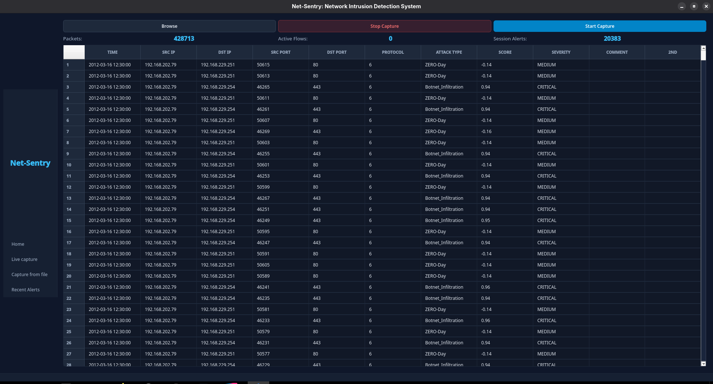
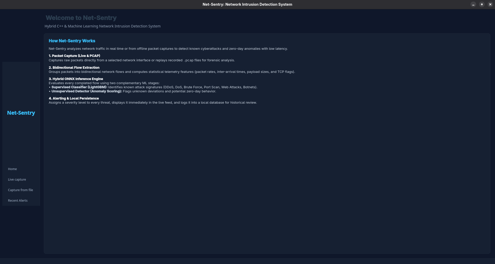

# 🛡️ NetSentry: Hybrid ML Network Intrusion Detection System

[](https://isocpp.org/)
[](https://www.qt.io/)
[](https://onnxruntime.ai/)
[](https://pcapplusplus.github.io/)
[](https://www.sqlite.org/)
[](LICENSE)

**NetSentry** is a native C++17 desktop Network Intrusion Detection System (NIDS). It captures live traffic or reads `.pcap` files, groups packets into bidirectional flows, and classifies each flow with a **two-stage ML cascade** running through ONNX Runtime, with no Python at runtime.

<p align="center">
  
</p>

---

## 📑 Contents

- [How it works](#-how-it-works)
- [Features](#-features)
- [Results](#-results)
- [Known limitations](#️-known-limitations)
- [Getting started](#-getting-started)
- [Training the models](#-training-the-models)
- [Project structure](#-project-structure)
- [Roadmap](#️-roadmap)
- [Author & license](#-author)

---

## 🧠 How it works

NetSentry uses a **cascade**, not two parallel detectors, and every flow gets a three-way decision:

1. **Known attack:** LightGBM is confident (each attack class has its own calibrated threshold) → alert with that class.
2. **Confidently benign:** LightGBM's benign probability reaches the configurable `benign_gate` → the flow is labelled Benign and **Stage 2 is skipped**.
3. **Uncertain:** everything in between goes to the Isolation Forest, which scores it as a possible anomaly.

So the Isolation Forest only judges flows the classifier cannot settle, which is where it adds value (see [Results](#-results)) and which keeps normal traffic from triggering false alarms.

```
┌──────────────────────┐     ┌───────────────────────────────────────┐
│ Live NIC / .pcap     │────▶│ Sniffer (PcapPlusPlus)                │
└──────────────────────┘     │ L2/L3/L4 parsing, TCP flags           │
                             └──────────────────┬────────────────────┘
                                                │ background thread
                                                ▼
                             ┌───────────────────────────────────────┐
                             │ FlowManager + FeatureExtractor        │
                             │ 5-tuple flow table, 1 s eviction,     │
                             │ 30-feature vector per flow            │
                             └──────────────────┬────────────────────┘
                                                ▼
                             ┌───────────────────────────────────────┐
                             │ Stage 1: LightGBM (ONNX)              │
                             │ Benign / DoS / DDoS / BruteForce /    │
                             │ Web Attack / Botnet_Infiltration      │
                             └──────────────────┬────────────────────┘
                                                │ uncertain flows only (see decision order)
                                                ▼
                             ┌───────────────────────────────────────┐
                             │ Stage 2: Isolation Forest (ONNX)      │
                             │ log1p-scaled features, anomaly score  │
                             │ below threshold → ZERO-Day (anomaly)  │
                             └──────────────────┬────────────────────┘
                                                │ Qt::QueuedConnection
                              ┌─────────────────┴─────────────────┐
                              ▼                                   ▼
                  ┌─────────────────────┐             ┌─────────────────────┐
                  │ Qt 6 GUI            │             │ SQLite alert store  │
                  │ live + offline views│             │ forensic history    │
                  └─────────────────────┘             └─────────────────────┘
```

**Decision order for each flow** (`Engine::predict`):

1. If any attack class has probability ≥ its own threshold → report that attack (stage: `LGBM`).
2. Else if P(Benign) ≥ `benign_gate` → Benign, Stage 2 skipped (stage: `LGBM`).
3. Else run the Isolation Forest: score < threshold → `ZERO-Day` (anomaly) alert, otherwise Benign.

| Stage | Model | Input | Decision rule |
|---|---|---|---|
| 1 | LightGBM (`ids_lightgbm.onnx`) | Raw 30-feature vector | Attack class reported if its probability reaches its own threshold; flow trusted as Benign if P(Benign) ≥ `benign_gate` |
| 2 | Isolation Forest (`isolation_forest.onnx`) | `log1p(max(x, 0))` of the features | Anomaly if score < `threshold` (default `-0.1288`) |

**Stage 1 per-class thresholds** (from `Models/ids_metadata.json`):

| Botnet_Infiltration | BruteForce | DDoS | DoS | Web Attack |
|---|---|---|---|---|
| 0.90 | 0.85 | 0.85 | 0.85 | 0.90 |

The thresholds are high on purpose: Stage 1 only names a known attack when it is very confident.

**Stage 2 and gate settings** (from `Models/unsup_metadata.json`, no recompilation needed):

| Key | Meaning |
|---|---|
| `threshold` | Anomaly cutoff; a flow is anomalous if its Isolation Forest score is below it |
| `benign_gate` | If LightGBM's P(Benign) is at or above this value, Stage 2 is skipped. A value above 1 (e.g. `1.01`) disables the gate and sends every unflagged flow to Stage 2 |

> The label `ZERO-Day` in the UI means **anomalous flow**, not a confirmed zero-day exploit.

---

## ✨ Features

- **Native packet and flow engine.** Live capture or offline `.pcap` / `.pcapng` analysis with PcapPlusPlus. Flows are keyed by 5-tuple and evicted on a 1-second window to keep memory flat.
- **30 flow features computed on the fly**, CICFlowMeter-style:
  - *Volume and rate (10):* Flow Duration, Total Fwd/Bwd Packets, Fwd/Bwd Packets Length Total, Flow Bytes/s, Fwd/Bwd Packets/s, Down/Up Ratio, Avg Packet Size
  - *Packet length (5):* Fwd and Bwd Packet Length Max/Mean, Packet Length Std
  - *Timing (6):* Flow IAT Mean/Std, Fwd IAT Total/Std, Active Mean, Idle Mean
  - *TCP and header (9):* FIN, SYN, RST, PSH, ACK flag counts, Fwd Header Length, Init Fwd/Bwd Win Bytes, Fwd Seg Size Min
- **Three-way cascade decision.** Known attacks are named by LightGBM, confident-benign flows bypass the anomaly stage, and only uncertain flows are scored by the Isolation Forest. Thresholds and the gate are plain JSON values you can tune without rebuilding.
- **Multi-threaded Qt 6 interface.** Capture and inference run off the UI thread and report back through queued signals. Views: Home, Live Capture, Capture from File, Recent Alerts.
- **Persistent alert history.** Every alert is stored in SQLite with timestamp, 5-tuple, scores, attack type and severity.

---

## 📊 Results

### Stage 1: LightGBM on CSE-CIC-IDS2018

Held-out test set (20% split) of 1,331,907 flows. **Accuracy: 98%, macro F1: 0.91.**

| Class | Precision | Recall | F1 | Support |
|---|---|---|---|---|
| Benign | 0.98 | 1.00 | 0.99 | 1,065,802 |
| Botnet_Infiltration | 0.97 | 0.55 | 0.70 | 52,604 |
| BruteForce | 1.00 | 1.00 | 1.00 | 18,820 |
| DDoS | 1.00 | 1.00 | 1.00 | 155,191 |
| DoS | 1.00 | 1.00 | 1.00 | 39,314 |
| Web Attack | 0.84 | 0.70 | 0.77 | 176 |
| **Macro avg** | **0.96** | **0.88** | **0.91** | 1,331,907 |

Accuracy is inflated by the large Benign class, so macro F1 is the more honest number. Web Attack has only 176 test flows, so treat its score as indicative, not conclusive.

### Stage 2: Isolation Forest (standalone)

Trained on benign flows only and evaluated on the same held-out test set (all attacks vs. benign). **ROC-AUC: 0.86**, so the anomaly scores separate attacks from normal traffic well.

Share of each class flagged at a fixed false-alarm rate on benign traffic (the Benign row is the false-alarm rate itself):

| Class | FPR 1% | FPR 2% | FPR 5% | FPR 10% | FPR 15% | FPR 20% |
|---|---|---|---|---|---|---|
| Benign (false alarms) | 0.01 | 0.02 | 0.05 | 0.10 | 0.15 | 0.20 |
| Botnet_Infiltration | 0.02 | 0.03 | 0.56 | 0.64 | 0.69 | 0.73 |
| BruteForce | 0.00 | 0.00 | 0.20 | 1.00 | 1.00 | 1.00 |
| DDoS | 0.00 | 0.00 | 0.00 | 0.59 | 0.59 | 0.71 |
| DoS | 0.02 | 0.04 | 0.06 | 0.40 | 0.53 | 0.93 |
| Web Attack | 0.23 | 0.32 | 0.36 | 0.48 | 0.55 | 0.65 |

What this shows:
- **It is strongest where LightGBM is weakest.** At 5% false alarms it flags 56% of botnet flows (Stage 1 recall: 0.55), and at 1% it already flags 23% of web attacks.
- **It is not a stand-alone detector.** At strict thresholds it catches little, and loosening it enough to catch most attacks would flood live traffic. That is why it only sees flows Stage 1 cannot settle, and why the benign gate exists.
- The shipped threshold (`-0.1288`) is a strict operating point (about 0.5% false alarms on CSE-CIC benign traffic) chosen to keep alert volume low.

### End-to-end stress test: MACCDC 2012

| Metric | Result |
|---|---|
| Packets processed | **428,713** in a single session |
| Crashes | 0, with flat memory use |
| Flows flagged | **20,383** |

These are *flagged* flows, not verified attacks: the capture has no per-flow ground truth. It is also a domain shift (models trained on 2018 data, tested on 2012 traffic).

### Demo

| Home | Capture from file (MACCDC 2012) |
|---|---|
|  |  |

---

## ⚠️ Known limitations

- **Botnet_Infiltration recall is 0.55.** About 45% of flows in this class are missed by Stage 1. The class merges two very different labels (`Bot` and `Infilteration`), and infiltration traffic is typically the hardest class in CSE-CIC-IDS2018 because it looks like normal activity.
- **The anomaly stage can raise false alarms on normal HTTPS traffic** in live capture, because live traffic is scored differently from the CSE-CIC benign flows it was trained on. The `benign_gate` limits how many confident-benign flows reach Stage 2, and calibrating the threshold on locally captured benign traffic is planned; before/after numbers will be added.
- **Stage 2 trades recall for false alarms.** See the table above: catching most attacks on its own would need a 5-10% false-alarm rate.
- **No cascade-level evaluation yet.** Stage 1 and Stage 2 are evaluated separately above; the combined pipeline's recall and false-positive rate (with and without the gate) are planned.
- **The UI can briefly show "not responding" when a very large capture starts**, then runs smoothly.
- **Dataset shift.** Training on CSE-CIC-IDS2018 and testing on MACCDC 2012 traffic is a stress test, not a benchmark.
- Throughput in packets per second has not been formally measured.

---

## 🚀 Getting started

### 1. Prerequisites (Fedora / Linux)

You need a C++17 compiler, CMake, Qt 6 development headers, libpcap, **PcapPlusPlus** and **ONNX Runtime**.

```bash
sudo dnf install cmake ninja-build gcc-c++ qt6-qtbase-devel libpcap-devel sqlite-devel
```

Set the PcapPlusPlus and ONNX Runtime include/lib paths in `CMakeLists.txt`.

### 2. Build

```bash
git clone https://github.com/Med-Atir/NetSentry.git
cd NetSentry
mkdir build && cd build
cmake -GNinja -DCMAKE_BUILD_TYPE=Release ..
ninja
```

### 3. Grant capture capabilities

To sniff live interfaces without running the GUI as root:

```bash
sudo setcap cap_net_raw,cap_net_admin=eip ./NetSentry
```

### 4. Run

```bash
./NetSentry
```

Pick **Live capture** and choose an interface, or **Capture from file** and select a `.pcap`. The trained models are included in `Models/`, so no retraining is needed.

---

## 🔬 Training the models

The models were trained offline and exported to ONNX. The full pipeline is in [`TrainingNotebook/netsentry_training.ipynb`](TrainingNotebook/netsentry_training.ipynb).

- **Dataset:** [CSE-CIC-IDS2018](https://www.unb.ca/cic/datasets/ids-2018.html) from the Canadian Institute for Cybersecurity (UNB). The notebook downloads it with `kagglehub`, which may need a Kaggle account or API token.
- **Split:** 80% train / 20% test.
- **Label mapping:** raw dataset labels are grouped into 6 classes:

| NetSentry class | Raw CSE-CIC-IDS2018 labels |
|---|---|
| Benign | Benign |
| Web Attack | Brute Force -Web, Brute Force -XSS, SQL Injection |
| BruteForce | FTP-BruteForce, SSH-Bruteforce |
| DoS | DoS attacks-Hulk, -GoldenEye, -Slowloris, -SlowHTTPTest |
| DDoS | DDOS attack-HOIC, DDoS attacks-LOIC-HTTP, DDOS attack-LOIC-UDP |
| Botnet_Infiltration | Bot, Infilteration |

- **Stage 1:** LightGBM multi-class classifier on the 30 raw features, with per-class thresholds chosen after training.
- **Stage 2:** Isolation Forest (250 trees, `max_samples=2048`, `random_state=49`) trained only on benign traffic after median imputation, with features preprocessed as `log1p(max(x, 0))`. The same preprocessing is applied in the C++ engine. The anomaly threshold is stored in `unsup_metadata.json`, so it can be changed without retraining.
- **Dependencies:** see the imports at the top of the notebook (LightGBM, scikit-learn, ONNX conversion tools, kagglehub).

---

## 📂 Project structure

```
NetSentry/
├── CMakeLists.txt        # Build configuration (Qt 6, PcapPlusPlus, ONNX Runtime)
├── main.cpp              # Application entry point
├── Headers/              # Class declarations
├── Sources/              # Sniffer, FlowManager, FeatureExtractor, Engine,
│                         #   Controller, DB, Qt pages
├── GUI/                  # Qt Designer .ui files
├── Models/               # ids_lightgbm.onnx, isolation_forest.onnx,
│                         #   ids_metadata.json, unsup_metadata.json
├── Database/             # SQLite alert storage
├── TrainingNotebook/     # Model training notebook
└── ScreenShots/          # README images
```

---

## 🗺️ Roadmap

- [x] Benign gate: skip Stage 2 for flows LightGBM is confident are benign
- [ ] Evaluate the full cascade (recall and FP rate vs. Stage 1 alone, with and without the gate) and choose the `benign_gate` value
- [ ] Calibrate the anomaly threshold on locally captured benign traffic
- [ ] Check whether the 1-second flow eviction matches the flow timeouts of the training data
- [ ] Improve Botnet_Infiltration recall
- [ ] Batched SQLite transactions for faster offline ingestion
- [ ] Risk gauge: map anomaly scores to a 0-100% scale with live charts
- [ ] Alert export (CSV / JSON)
- [ ] Optional IPS mode (`iptables` / `nftables` drop rules)
- [ ] Measure and publish packets-per-second throughput

---

## 👤 Author

**Mohammed Atir**, Cybersecurity Engineering Student (ISSIC) at École des Sciences de l'Information (ESI), Rabat
[LinkedIn](https://www.linkedin.com/in/atir-mohammed-a00a2434b/)

## 📄 License

Apache License 2.0. See [LICENSE](LICENSE).
